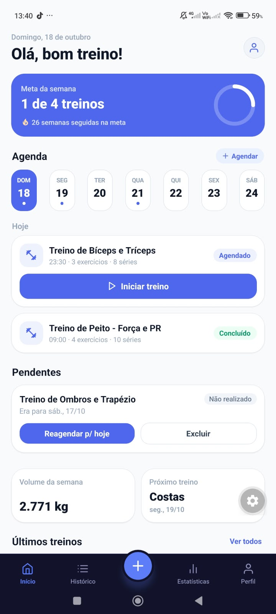
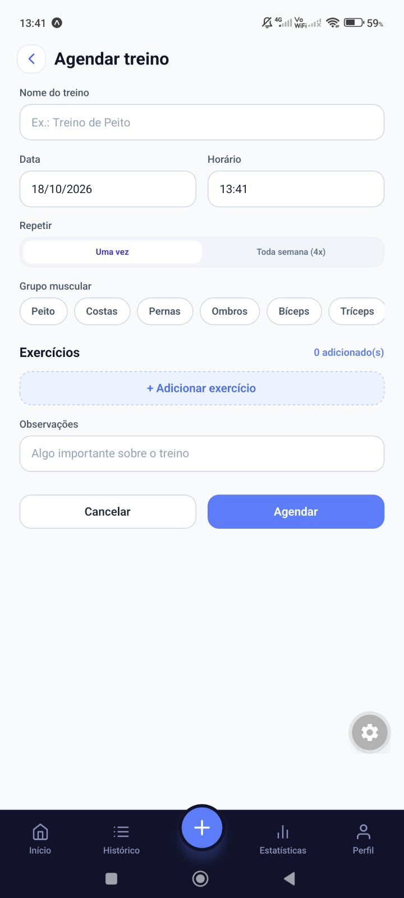
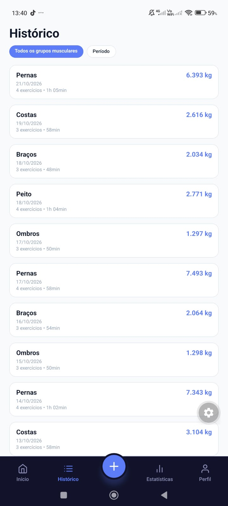
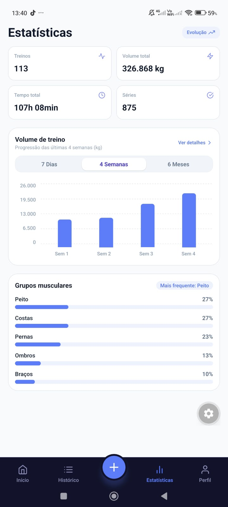
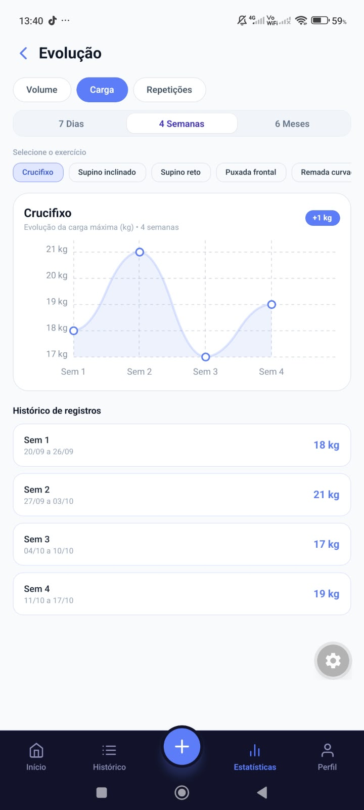

# 🏋️‍♂️ GymLog — Diário e Planejador de Treinos Offline-First

O **GymLog** é um aplicativo móvel desenvolvido em **React Native com Expo** para quem deseja planejar sua rotina de academia, executar treinos em tempo real com cronômetro e acompanhar sua evolução física com gráficos detalhados — combinando **persistência local instantânea (SQLite)**, **sincronização em nuvem (Supabase)** e arquitetura **Offline-First com fila persistente de requisições**.

> 📄 **Documentação Acadêmica Completa (Projeto 1 & Projeto 2):** Para consultar o detalhamento do modelo de dados local e em nuvem (diagramas ER), a arquitetura *Offline-First* com fila FIFO, a justificativa técnica da camada de persistência e os requisitos atendidos da disciplina de *Programação para Dispositivos Móveis (IFPB)*, acesse [**`docs/DOCUMENTACAO.md`**](./docs/DOCUMENTACAO.md).

---

## 🎯 Tema e Objetivo

Manter a constância nos treinos e aplicar a progressão de carga fica muito mais simples quando seus dados estão sempre acessíveis, independentemente do sinal de internet da academia. O **GymLog** substitui anotações improvisadas por uma experiência fluida, moderna e resiliente a falhas de rede:

- **Conta na nuvem com isolamento local:** Crie sua conta e faça login via **Supabase Auth**. Cada usuário possui seu próprio banco SQLite isolado no dispositivo e sincronizado com o PostgreSQL na nuvem.
- **Arquitetura Offline-First real:** Sem internet na academia? Todas as criações, edições, conclusões de treino e exclusões são gravadas imediatamente no **SQLite local** e entram em uma **fila persistente FIFO (`AsyncStorage`)**, sendo enviadas automaticamente em ordem ao **Supabase** assim que a conexão é restabelecida.
- **Planeje sua semana:** Agende seus treinos por dia, horário e grupo muscular, com opção de recorrência semanal automática (`4x`).
- **Não deixe treinos passarem em branco:** Treinos agendados em datas/horários passados e não concluídos aparecem na seção **Pendentes** da tela inicial para reagendamento rápido para hoje ou exclusão.
- **Registre tudo em tempo real (Live Workout):** Inicie um treino agendado com cronômetro ao vivo, timer flutuante de descanso automático entre séries e ajuste rápido de cargas e repetições.
- **Visualize e exporte seu progresso:** Acompanhe gráficos de volume, distribuição muscular, curva de evolução por exercício e exporte um **Relatório Completo em PDF** com gráficos vetoriais (SVG).

---

## ✨ Funcionalidades

- **Autenticação e Persistência na Nuvem (Supabase):**
  - Cadastro de usuário (com validação de e-mail, senha e idade mínima), Login com sessão persistente e Logout seguro.
  - Sincronização em nuvem de treinos, séries de exercícios e preferências do perfil no **Supabase (PostgreSQL)**, com restauração automática do histórico ao entrar em um novo dispositivo.
- **Motor Offline-First com Fila de Sincronização (FIFO):**
  - Monitoramento contínuo de conectividade via `expo-network` e ciclo de vida do app (`AppState`).
  - Todas as mutações ocorrem primeiro no banco SQLite local e geram operações tipadas (`UPSERT_TREINO`, `DELETE_TREINO`, `UPSERT_PERFIL`) em uma fila persistente com coalescência inteligente.
  - **Feedback visual em tempo real:** Banner dinâmico na Tela Inicial (*"Sem conexão"* / *"Sincronizando fila com a nuvem..."*) e painel de status de sincronização no Perfil.
- **CRUD Completo de Treinos e Exercícios:** Criação/agendamento (único ou recorrente semanal), listagem, visualização detalhada, edição completa de treinos/horários/séries, reagendamento em um toque e exclusão com confirmação de segurança.
- **Execução de Treino ao Vivo (`Live Workout`):** Cronômetro da sessão, barra de progresso de séries e volume (kg), marcação individual de séries com feedback tátil (`expo-haptics`) e timer regressivo de descanso.
- **Listagem Inteligente no Histórico:** Filtragem combinada por **grupo muscular** (*Peito, Costas, Pernas, Ombros, Bíceps, Tríceps*) e por **período** (*Últimos 7 dias, 30 dias, 3 meses, Todo o período ou Intervalo Personalizado*), com ordenação cronológica.
- **Validação de Formulários:** Campos validados com **React Hook Form + Zod** e feedback visual imediato para evitar treinos sem nome, datas/horários passados no agendamento ou séries vazias.
- **Gráficos de Estatísticas e Evolução *(Extra)*:**
  - Painel de métricas gerais (*Treinos concluídos, Volume total em kg, Tempo total e Séries*).
  - Gráfico de barras de volume de treino (*7 Dias, 4 Semanas e 6 Meses*) e ranking percentual de grupos musculares.
  - Gráfico de linha em curva de Bézier para acompanhar a progressão de **Carga**, **Volume** ou **Repetições** por exercício individual.
- **Exportação de Relatório em PDF *(Extra)*:** Geração e compartilhamento (ou salvamento direto no aparelho) de um relatório executivo `.pdf` contendo métricas gerais, gráficos SVG de evolução/distribuição muscular e histórico completo de treinos (`expo-print` + `expo-file-system` + `expo-sharing`).
- **Tema Claro e Escuro *(Extra)*:** Interface adaptável com troca instantânea nas telas de autenticação e no Perfil, com persistência da preferência do usuário.
- **Lembretes e Notificações Locais *(Extra)*:** Avisos automáticos antes do horário do treino agendado, com tempo de antecedência configurável (*5 a 60 minutos*) via `expo-notifications`.

---

## 📱 Prints do Aplicativo

| Tela Inicial (Dashboard e Pendentes) | Agendar Novo Treino | Histórico com Filtros |
| :---: | :---: | :---: |
|  |  |  |

| Estatísticas e Volume | Evolução por Exercício | Perfil e Configurações |
| :---: | :---: | :---: |
|  |  |  |

---

## 🛠️ Tecnologias Utilizadas

| Categoria | Tecnologia | Papel no Projeto |
| :--- | :--- | :--- |
| **Framework Mobile** | [React Native](https://reactnative.dev/) (`0.88`) + [Expo SDK 58](https://expo.dev/) | Base multiplataforma (Android, iOS e Web) |
| **Linguagem** | [TypeScript](https://www.typescriptlang.org/) | Tipagem estática em todas as camadas de banco, sincronização, rotas e UI |
| **Backend & Auth (Nuvem)** | [Supabase](https://supabase.com/) (`@supabase/supabase-js`) | Autenticação de usuários (JWT) e persistência remota em PostgreSQL |
| **Banco de Dados Local** | [Expo SQLite](https://docs.expo.dev/versions/latest/sdk/sqlite/) (`expo-sqlite`) | Persistência relacional local isolada por usuário (com transações e migrations) |
| **Motor Offline-First** | `expo-network` + [Zustand](https://zustand-demo.pmnd.rs/) + [AsyncStorage](https://react-native-async-storage.github.io/async-storage/) | Detecção de conectividade e fila persistente FIFO de requisições pendentes |
| **Navegação** | [Expo Router](https://docs.expo.dev/router/introduction/) | Roteamento *file-based* com proteção de rotas (`(auth)` e `(tabs)`) |
| **Estilização** | [NativeWind v4](https://www.nativewind.dev/) (Tailwind CSS) | Estilização responsiva e suporte a variáveis de tema claro/escuro |
| **Formulários e Validação** | [React Hook Form](https://react-hook-form.com/) + [Zod](https://zod.dev/) | Controle performático de formulários e validação de esquemas |
| **Gráficos e Visualização** | `react-native-chart-kit` + `react-native-svg` | Gráficos de barras (volume), anel de meta semanal e curvas de evolução |
| **Relatório PDF e Notificações** | `expo-print`, `expo-file-system`, `expo-sharing`, `expo-notifications` | Exportação de relatório em PDF com gráficos SVG e lembretes locais agendados |

---

## 📂 Arquitetura do Projeto

O código-fonte está organizado dentro de `src/` seguindo uma separação clara de responsabilidades entre interface, autenticação, motor de sincronização *Offline-First*, validação e persistência de dados:

```text
Gymlog/
├── docs/
│   ├── DOCUMENTACAO.md                  # Documentação técnica (Tema, Modelo Local/Nuvem, Offline-First e Prints)
│   └── screenshots/                     # Capturas de tela do aplicativo em execução
├── src/
│   ├── app/                             # Rotas e telas (Expo Router)
│   │   ├── (auth)/                      # Fluxo de autenticação (login.tsx, cadastro.tsx, esqueci-senha.tsx)
│   │   ├── (tabs)/                      # Navegação principal (Início, Histórico, Novo Treino, Estatísticas, Perfil)
│   │   ├── treino-ativo/[id].tsx        # Execução de treino em tempo real (cronômetro e timer de descanso)
│   │   └── _layout.tsx                  # Guardião de rotas Auth, inicialização do SQLite e Tema
│   ├── components/                      # Componentes reutilizáveis de UI
│   │   ├── dashboard/                   # Cards do Início e BannerSincronizacao.tsx (status Offline-First)
│   │   ├── exercicio/                   # BottomSheetSelecionarExercicio.tsx
│   │   ├── perfil/                      # ModalLembretes.tsx
│   │   ├── treino-ativo/                # CronometroSessao, CardExercicioAoVivo, BarraDescansoFlutuante
│   │   └── ui/                          # Inputs, Botões, ChipsFiltro, SeletorData, Toast
│   ├── contexts/
│   │   └── AuthContext.tsx              # Provedor de sessão do Supabase, troca de banco por usuário e bootstrap da nuvem
│   ├── database/                        # Camada de persistência local SQLite
│   │   ├── conexao.ts                   # Proxy multiusuário do SQLite (gymlog_user_<id>.db) e fallback Web
│   │   ├── initDatabase.ts              # Criação de tabelas, Foreign Keys, índices e migrações automáticas
│   │   ├── treinoRepository.ts          # Operações CRUD transacionais integradas ao enfileiramento Offline-First
│   │   ├── configuracoesRepository.ts   # Persistência local de metas e preferências do usuário
│   │   ├── inicioConsultas.ts           # Consultas da agenda semanal, resumo e treinos pendentes
│   │   ├── treinoConsultas.ts           # Listagem e detalhes de treinos
│   │   ├── estatisticasConsultas.ts     # Agregações SQL para gráficos de volume, distribuição e evolução
│   │   └── perfilConsultas.ts           # Cálculo de recordes (PRs), sequência (streak) e dados de relatório
│   ├── services/                        # Integrações externas e serviços nativos
│   │   ├── supabase.ts                  # Cliente Supabase com sessão persistida no AsyncStorage
│   │   ├── sincronizacaoSupabase.ts     # Motor Offline-First: monitoramento de rede e processamento FIFO da fila
│   │   ├── exportarPdf.ts               # Geração de relatório executivo em PDF com gráficos SVG
│   │   └── notificacoesService.ts       # Agendamento e sincronização de lembretes locais
│   ├── stores/                          # Gerenciamento de estado global (Zustand)
│   │   ├── useSyncStore.ts              # Fila persistente FIFO de operações Offline-First por usuário
│   │   ├── useThemeStore.ts             # Estado global e persistência do Tema Claro/Escuro
│   │   ├── useLiveWorkoutStore.ts       # Estado da sessão de treino ao vivo e cronômetros
│   │   └── useAgendamentoStore.ts       # Estado temporário da montagem de exercícios no agendamento
│   └── utils/                           # Formatadores de datas, máscaras e filtros do histórico
├── .env.example                         # Modelo de variáveis de ambiente para conexão com o Supabase
├── app.json                             # Configurações do Expo e plugins nativos
└── package.json                         # Dependências e scripts do projeto
```

---

## 🚀 Instruções de Execução

### Pré-requisitos
- **Node.js** (versão 18 ou superior recomendada)
- Gerenciador de pacotes **npm** (ou **Bun**)
- Aplicativo **Expo Go** instalado no celular Android ou iOS (ou emulador Android Studio configurado)

### Passo a passo para rodar o projeto

1. **Clone o repositório e acesse a pasta do projeto:**
   ```bash
   git clone https://github.com/ruan-gouveia/Gymlog.git
   cd Gymlog
   ```

2. **Instale as dependências:**
   ```bash
   npm install
   ```

3. **Configure as variáveis de ambiente do Supabase (`.env`):**
   Copie o arquivo `.env.example` para `.env` na raiz do projeto e preencha com a URL e a *Anon Key* do projeto Supabase (enviadas junto à entrega da avaliação):
   ```bash
   cp .env.example .env
   ```
   Conteúdo do arquivo `.env`:
   ```env
   EXPO_PUBLIC_SUPABASE_URL=https://seu-projeto.supabase.co
   EXPO_PUBLIC_SUPABASE_ANON_KEY=sua-chave-anon-publica
   ```

4. **Inicie o servidor de desenvolvimento do Expo:**
   ```bash
   npx expo start
   ```

5. **Abra o aplicativo:**
   - **No celular físico (Recomendado):** Abra o aplicativo **Expo Go**, escaneie o QR Code exibido no terminal e aguarde o carregamento.
   - **No emulador Android:** Pressione a tecla **`a`** no terminal com o emulador aberto.
   - **No navegador (Web / Localhost):** Pressione a tecla **`w`** no terminal ou acesse `http://localhost:8081`.

### Scripts úteis de verificação

```bash
npx tsc --noEmit   # Verifica a tipagem TypeScript em todo o projeto
npx eslint src     # Executa o linter (ESLint) no código-fonte
```

---

## 👥 Integrantes do Grupo

| Integrante | GitHub |
| :--- | :--- |
| **Ruan Gouveia** | [@ruan-gouveia](https://github.com/ruan-gouveia) |
| **Mateus Miranda** | [@Mateus23-silva](https://github.com/Mateus23-silva) |
| **Arthur Henrique** | [@4rthurhr](https://github.com/4rthurhr) |

---

## 📚 Documentação Adicional

- [**Documentação Técnica do Projeto (`docs/DOCUMENTACAO.md`)**](./docs/DOCUMENTACAO.md) — Contém o detalhamento do tema, diagramas Entidade-Relacionamento (ER) do banco local (SQLite) e do backend na nuvem (Supabase), explicação detalhada da arquitetura *Offline-First* com fila FIFO, justificativa técnica das tecnologias de persistência e galeria comentada das telas.
