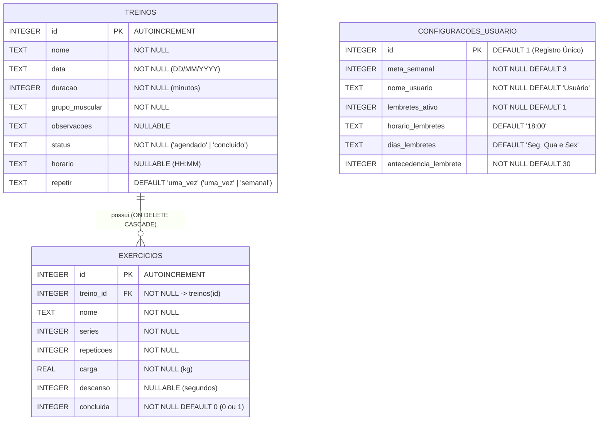
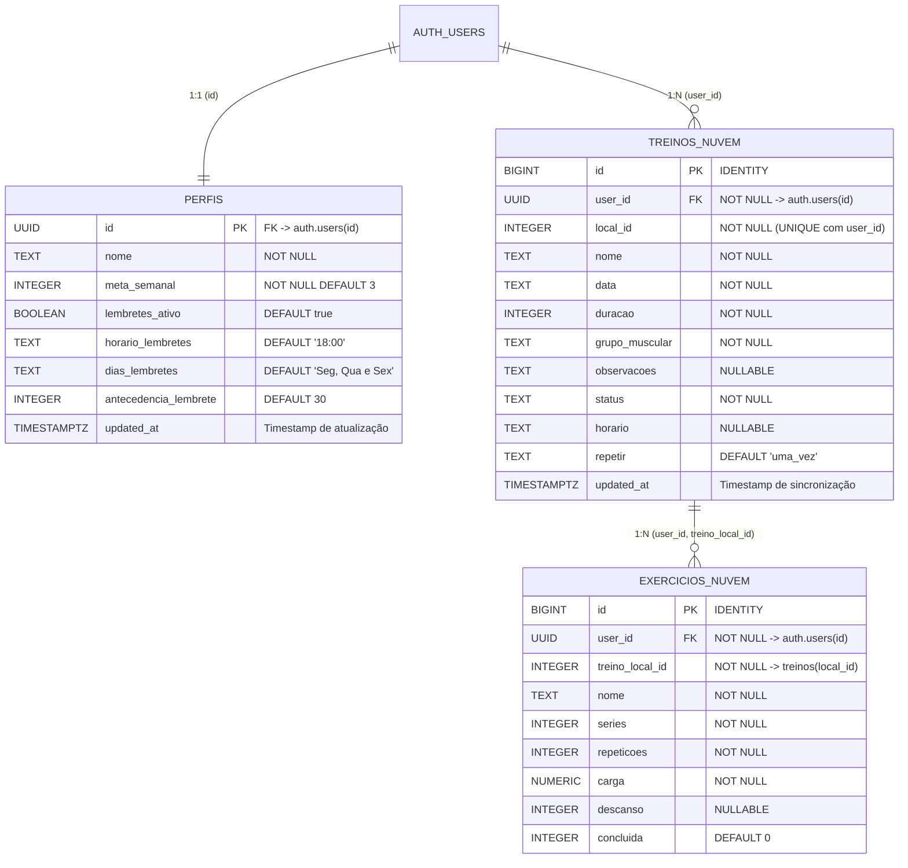
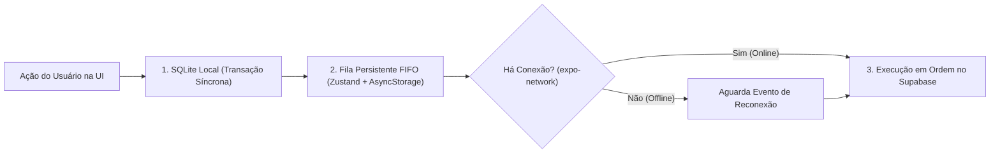
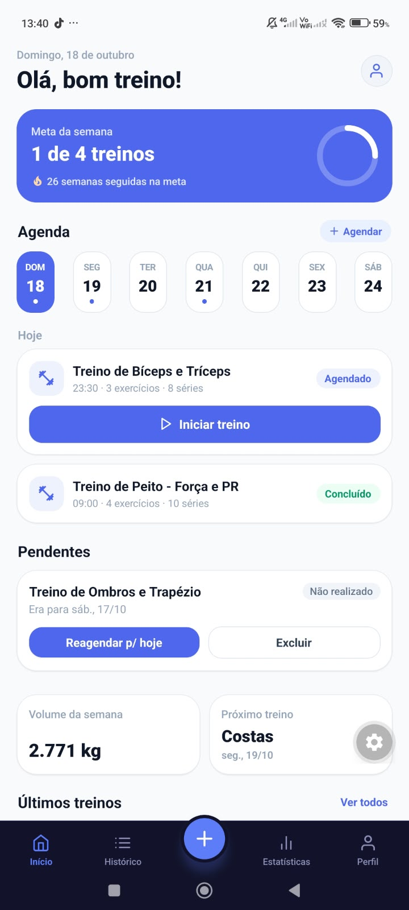
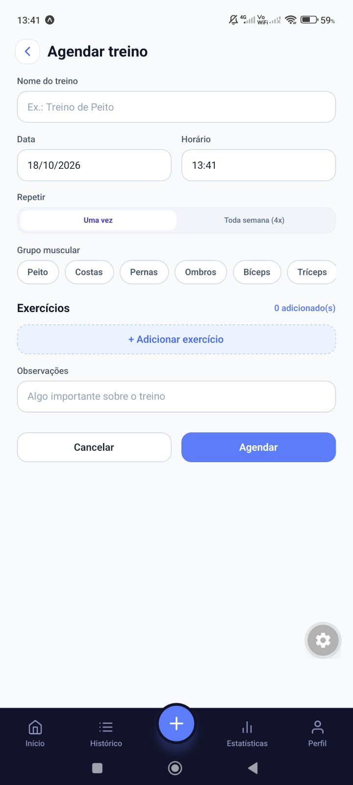
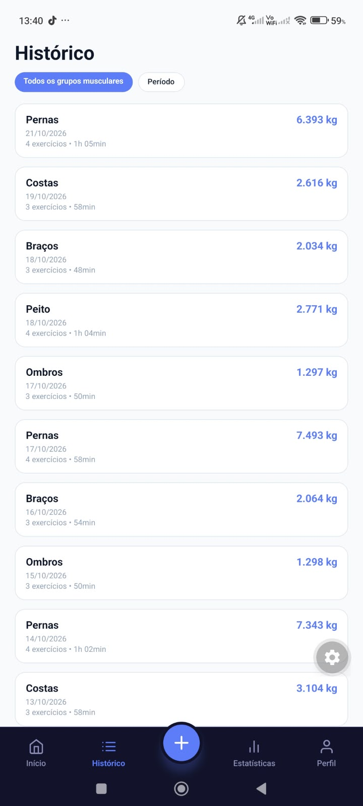
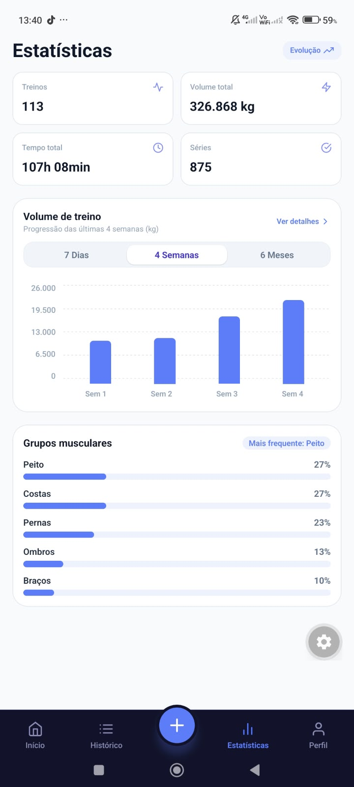
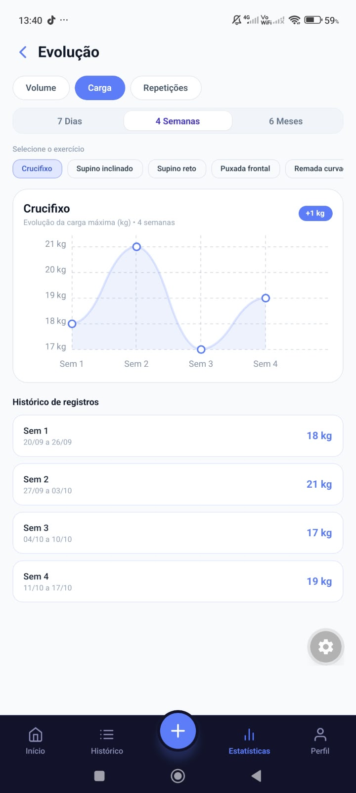
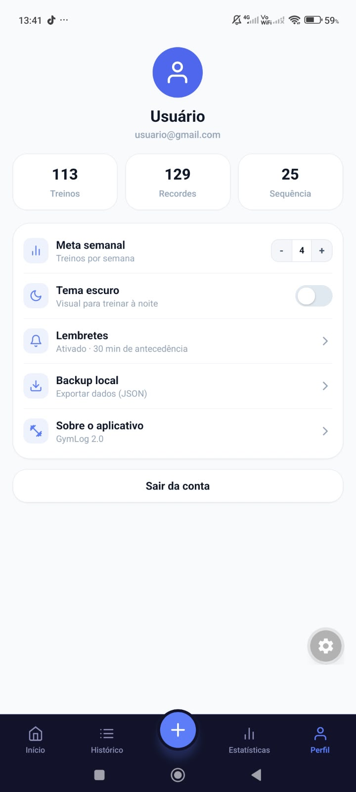

# Documentação do Projeto — GymLog (Fase 1 e Fase 2)

**Instituição:** Instituto Federal da Paraíba (IFPB) — Campus Esperança  
**Curso:** CST em Análise e Desenvolvimento de Sistemas  
**Disciplina:** Programação para Dispositivos Móveis (2026.2)  
**Professor:** Prof. André Atanasio  

### Integrantes da Equipe
- **Ruan Gouveia** — [github.com/ruan-gouveia](https://github.com/ruan-gouveia)
- **Mateus Miranda** — [github.com/Mateus23-silva](https://github.com/Mateus23-silva)
- **Arthur Henrique** — [github.com/4rthurhr](https://github.com/4rthurhr)

---

## 1. Tema e Proposta do Aplicativo

O **GymLog** é um aplicativo móvel voltado para o **planejamento, execução ao vivo e análise estatística de treinos de musculação**, projetado sob uma arquitetura **Offline-First** com persistência local em **SQLite** e sincronização automática em nuvem via **Supabase (PostgreSQL + Auth)**.

Quem treina regularmente sabe como é fácil perder a conta de qual carga usou na semana passada, esquecer um treino agendado na correria do dia a dia ou enfrentar sinal de internet instável dentro da academia. O GymLog resolve esse problema unindo o melhor dos dois mundos:
1. **Usabilidade instantânea mesmo sem internet (Offline-First):** Todas as operações são salvas imediatamente no banco SQLite local do dispositivo e enfileiradas em uma fila persistente de sincronização.
2. **Segurança e portabilidade na nuvem (Backend Supabase):** Assim que o aparelho encontra conexão, a fila de requisições é processada em ordem (FIFO), mantendo o histórico e as preferências do usuário seguros na nuvem e associados à sua conta autenticada.

### Principais Funcionalidades Implementadas
- **Autenticação de Usuários na Nuvem *(Projeto 2)*:** Fluxo completo de Cadastro (com validação de dados e idade mínima de 12 anos), Login com sessão JWT persistida e Logout utilizando **Supabase Auth**, com isolamento automático do banco SQLite local por usuário (`gymlog_user_<userId>.db`).
- **Sincronização em Nuvem e Arquitetura Offline-First com Fila FIFO *(Projeto 2)*:**
  - Todas as alterações de treinos, séries e perfil ocorrem primeiro no SQLite local e geram comandos na fila persistente (`@gymlog:fila_sync:<userId>`).
  - Monitoramento automático de rede via `expo-network` e ciclo de vida do aplicativo (`AppState`): quando a internet cai, um banner âmbar informa o modo offline e a quantidade de operações aguardando envio; quando a conexão retorna, a fila é executada sequencialmente no Supabase sem bloquear a interface.
  - Restauração automática da nuvem (`carregarDadosIniciaisDaNuvem`) ao fazer login em um dispositivo com banco local limpo.
- **Planejamento e Agendamento (CRUD Completo):** Criação de treinos personalizados com data, horário, opção de repetição semanal (`4x`), grupo muscular principal, observações e lista dinâmica de exercícios selecionados via *Bottom Sheet* (séries, repetições, carga em kg e tempo de descanso). Permite visualizar detalhes, editar qualquer treino, horário ou série, reagendar treinos atrasados e excluir registros com confirmação de segurança.
- **Execução de Treino ao Vivo (`Live Workout`):** Modo dedicado para o momento do treino, com cronômetro integrado da sessão, barra de progresso de séries e volume levantado, marcação individual de séries concluídas com feedback tátil (`expo-haptics`) e timer regressivo flutuante de descanso.
- **Gestão Inteligente da Rotina (Início):** Painel diário com saudação personalizada, banner de status da sincronização *Offline-First*, progresso da meta semanal, sequência (*streak*) de semanas batendo a meta, calendário horizontal da semana, alerta automático de **Treinos Pendentes** (com ação rápida para reagendar para hoje ou excluir) e resumo do volume semanal.
- **Histórico com Listagem Inteligente:** Consulta de todos os treinos concluídos com filtragem combinada por **grupo muscular** (*Peito, Costas, Pernas, Ombros, Bíceps, Tríceps*) e por **período** (*Últimos 7 dias, 30 dias, 3 meses, Todo o período ou Personalizado*), ordenada do treino mais recente para o mais antigo.
- **Estatísticas e Gráficos de Evolução *(Extra)*:**
  - Painel geral com indicadores acumulados (total de treinos, volume movimentado em kg, tempo total de treino e séries concluídas), gráfico de barras do volume por período (*7 Dias, 4 Semanas, 6 Meses*) e distribuição percentual de grupos musculares trabalhados.
  - Tela de **Evolução por Exercício** com gráfico de linha suavizado (curva de Bézier) que acompanha a progressão de **Carga máxima**, **Volume** ou **Repetições** em cada exercício específico ao longo do tempo.
- **Exportação de Relatório Executivo em PDF *(Extra)*:** Geração de documento `.pdf` estilizado (`expo-print`) contendo capa personalizada, resumo de métricas e recordes, gráficos vetoriais (SVG) de evolução de volume, distribuição muscular em rosca e progressão de carga dos principais exercícios, além da tabela completa de treinos realizados — permitindo compartilhar ou salvar diretamente no armazenamento do dispositivo (`expo-file-system` + `expo-sharing`).
- **Notificações Locais e Lembretes *(Extra)*:** Agendamento automático de notificações locais (`expo-notifications`) que avisam o usuário antes do horário programado para o treino, com tempo de antecedência configurável (*5, 10, 15, 30 ou 60 minutos*).
- **Tema Claro e Escuro *(Extra)*:** Alternância instantânea entre modo claro e modo escuro em todas as telas (incluindo Login/Cadastro) e gráficos do aplicativo.

---

## 2. Modelo de Dados (Local e Nuvem)

A camada de dados do **GymLog** opera em dois níveis espelhados: o banco relacional local em **SQLite** (isolado por usuário autenticado no dispositivo) e o banco relacional remoto em **PostgreSQL no Supabase**.

### 2.1. Modelo Relacional Local (`SQLite` — `gymlog_user_<userId>.db`)

O banco local possui integridade referencial ativa (`PRAGMA foreign_keys = ON`) e índices otimizados para consultas por data e status:

### 2.2. Modelo Relacional na Nuvem (`Supabase / PostgreSQL`)

No backend **Supabase**, os dados de cada praticante são vinculados ao seu identificador único (`user_id` referenciando `auth.users`) e utilizam a chave composta `(user_id, local_id)` para garantir **idempotência** nos *upserts* da fila de sincronização *Offline-First*:

---

## 3. Arquitetura Offline-First e Justificativa da Camada de Persistência

Para atender com excelência aos requisitos do **Projeto 2**, implementamos uma arquitetura **Offline-First** em três camadas coordenadas:

### 3.1. Persistência Local Primária com `expo-sqlite`
1. **Latência Zero e Resiliência a Oscilações de Rede:** Toda operação de criação, edição, conclusão ao vivo, reagendamento ou exclusão de treino é gravada primeiro no **SQLite local** dentro de uma transação atômica (`db.withTransactionSync`). A interface gráfica lê diretamente do SQLite, de modo que o usuário nunca sofre com travamentos, *spinners* infinitos ou perda de dados quando a internet da academia oscila ou cai completamente.
2. **Isolamento Multiusuário no Dispositivo:** O módulo `src/database/conexao.ts` utiliza um `Proxy` dinâmico que alterna automaticamente o arquivo físico do SQLite conforme o `user.id` da sessão autenticada (`gymlog_user_<userId>.db`), garantindo que múltiplos usuários possam logar no mesmo aparelho com isolamento total de dados locais.
3. **Consultas Analíticas Rápidas:** Filtros temporais, cálculo de volume ($\text{séries} \times \text{repetições} \times \text{carga}$), detecção de recordes pessoais (PRs) e agregações para os gráficos da tela de Estatísticas e do Relatório PDF são processados instantaneamente via SQL indexado (`idx_treinos_data_status` e `idx_exercicios_treino_id`).

### 3.2. Fila Persistente de Requisições (`useSyncStore` + `AsyncStorage`)
Sempre que o repositório local conclui uma escrita no SQLite, ele enfileira um item tipado (`UPSERT_TREINO`, `DELETE_TREINO` ou `UPSERT_PERFIL`) na store `useSyncStore`, que persiste imediatamente a fila no `AsyncStorage` sob a chave `@gymlog:fila_sync:<userId>`:
- **Ordem Garantida (FIFO):** Os itens são consumidos estritamente do primeiro ao último (`fila[0]`), preservando a ordem cronológica das ações feitas offline.
- **Coalescência Inteligente de Operações Offline:**
  - Se o usuário criar ou editar o mesmo treino várias vezes enquanto estiver offline, a fila atualiza o payload do `UPSERT_TREINO` pendente daquele `entidadeId` em vez de gerar requisições redundantes.
  - Se o usuário excluir offline um treino que tinha atualizações pendentes na fila, os `UPSERT_TREINO` anteriores daquele treino são removidos da fila e substituídos pelo `DELETE_TREINO`.
- **Tolerância a Falhas:** Caso uma requisição falhe por queda brusca de conexão no meio do envio, o item **não é descartado**: o erro e o contador de tentativas são registrados no item, a fila pausa o processamento e retoma automaticamente assim que a conexão estabilizar.

### 3.3. Backend na Nuvem com `Supabase` e Monitoramento via `expo-network`
O serviço `src/services/sincronizacaoSupabase.ts` gerencia o ciclo de sincronização com o **Supabase**:
- Escuta eventos de mudança de rede em tempo real (`Network.addNetworkStateListener`) e retorno do aplicativo ao primeiro plano (`AppState`).
- Ao detectar conexão ativa, dispara `processarFilaSincronizacao()`, executando cada operação no PostgreSQL remoto via `@supabase/supabase-js` (`upsert` com resolução de conflito em `user_id,local_id`) e removendo o item da fila local somente após confirmação de sucesso do servidor.

---

## 4. Capturas de Tela da Aplicação

Abaixo estão as principais telas do **GymLog** em funcionamento, demonstrando o fluxo completo desde o painel diário e agendamento até o histórico, análises gráficas de evolução e configurações de perfil:

| Tela Inicial (Agenda, Hoje e Pendentes) | Agendar Novo Treino (Validação e Séries) |
| :---: | :---: |
|  |  |
| *Acompanhamento da meta semanal, calendário da semana, treinos do dia e alerta de treinos pendentes com opção de reagendar ou excluir.* | *Formulário completo para planejar treinos futuros ou recorrentes, selecionar grupo muscular e adicionar exercícios via Bottom Sheet.* |

| Histórico de Treinos (Filtros Inteligentes) | Estatísticas Gerais e Grupos Musculares |
| :---: | :---: |
|  |  |
| *Listagem cronológica dos treinos concluídos com filtragem por grupo muscular e período, exibindo duração e volume total.* | *Resumo acumulado de treinos, volume total (kg), tempo e séries, gráfico de barras por período e distribuição muscular.* |

| Evolução por Exercício (Curva de Progresso) | Perfil, Sincronização, Lembretes e PDF |
| :---: | :---: |
|  |  |
| *Gráfico de linha acompanhando a evolução de carga, volume ou repetições em cada exercício e histórico detalhado de registros.* | *Resumo de recordes e sequência, ajuste da meta semanal, tema escuro, lembretes locais, status de sincronização Supabase e exportação de relatório.* |
