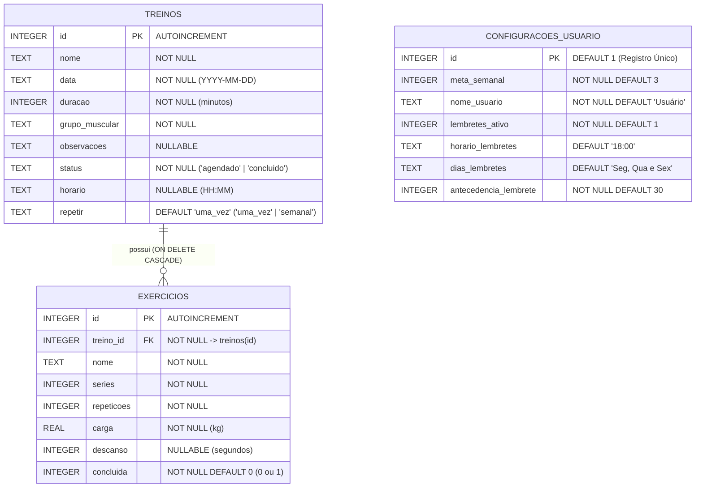
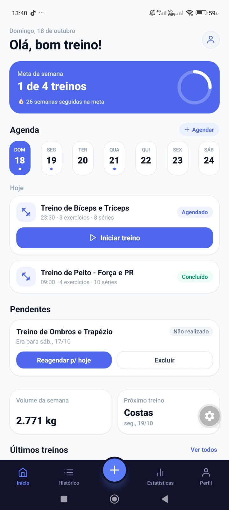
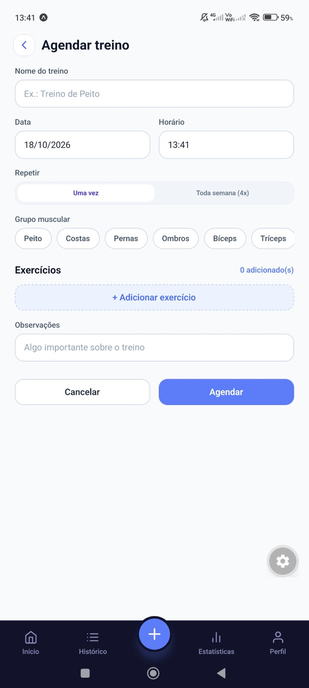
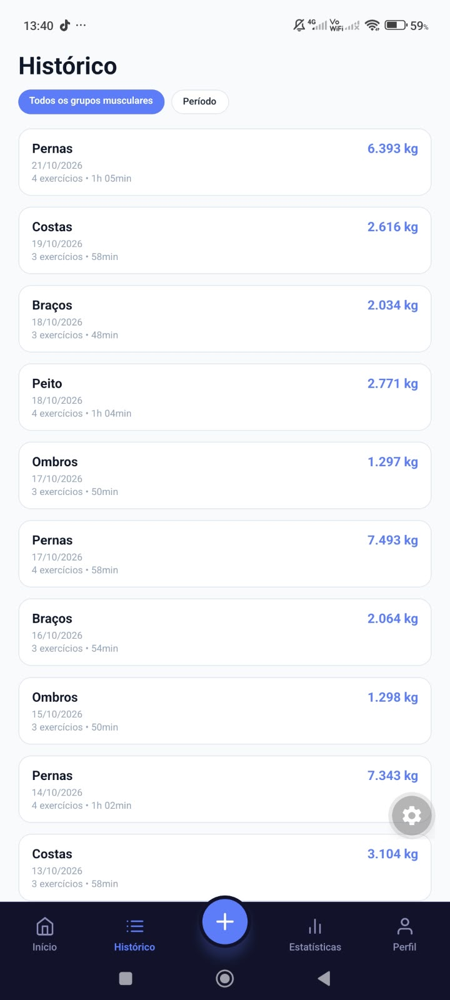
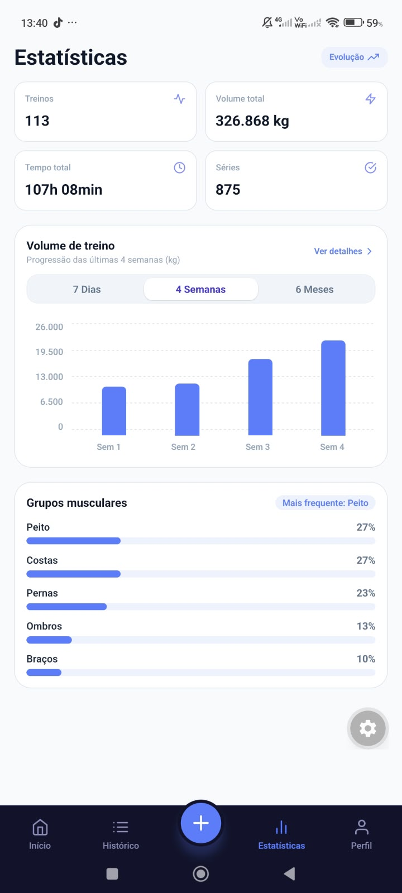
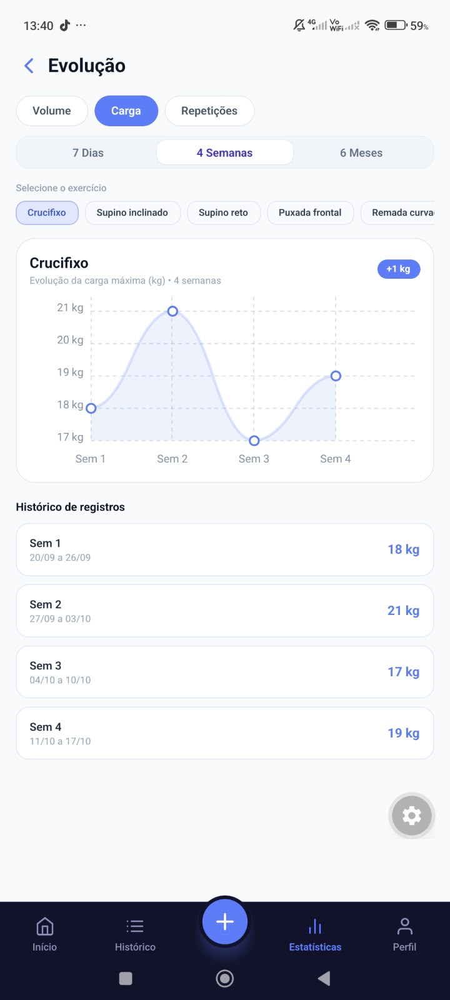

# Documentação do Projeto — GymLog

**Instituição:** Instituto Federal da Paraíba (IFPB) — Campus Esperança  
**Curso:** CST em Análise e Desenvolvimento de Sistemas  
**Disciplina:** Programação para Dispositivos Móveis (2026.2)  
**Professor:** Prof. André Atanasio  

### Integrantes da Equipe
- **Ruan Gouveia** — [github.com/ruan-gouveia](https://github.com/ruan-gouveia)
- **Mateus Miranda** — [github.com/Mateus23-silva](https://github.com/Mateus23-silva)
- **Arthur Henrique** — [github.com/4rthurhr](https://github.com/4rthurhr)

---

## 1. Tema e Proposta do Aplicativo

O **GymLog** é um aplicativo móvel voltado para o **planejamento, acompanhamento e análise de treinos de musculação**, funcionando 100% offline. 

Quem treina regularmente sabe como é fácil perder a conta de qual carga usou na semana passada, esquecer um treino agendado na correria do dia a dia ou não perceber o próprio progresso ao longo dos meses. O GymLog nasceu justamente para resolver essa dor de forma simples e direta: permitir que o praticante organize sua rotina semanal de treinos, registre cada série, repetição e carga em tempo real na academia e acompanhe sua evolução física através de gráficos claros e intuitivos — tudo salvo localmente no próprio aparelho, sem depender de sinal de internet ou servidores externos.

### Principais Funcionalidades Implementadas
- **Planejamento e Agendamento (CRUD Completo):** Criação de treinos personalizados com data, horário, opção de repetição semanal (`4x`), grupo muscular principal, observações e lista dinâmica de exercícios (séries, repetições, carga em kg e tempo de descanso). Permite visualizar detalhes, editar qualquer treino ou série, reagendar treinos atrasados e excluir registros com confirmação de segurança.
- **Execução de Treino ao Vivo:** Modo dedicado para o momento do treino, com cronômetro integrado e marcação individual de exercícios concluídos, calculando automaticamente a duração da sessão ao finalizar.
- **Gestão Inteligente da Rotina (Início):** Painel diário com saudação contextual, progresso da meta semanal, sequência (*streak*) de semanas batendo a meta, calendário horizontal da semana, alerta automático de **Treinos Pendentes** (agendados em datas/horários passados e ainda não realizados, com ação rápida para reagendar para hoje ou excluir) e resumo do volume semanal e próximo treino.
- **Histórico com Listagem Inteligente:** Consulta de todos os treinos concluídos com filtragem combinada por **grupo muscular** (*Peito, Costas, Pernas, Ombros, Bíceps, Tríceps*) e por **período** (*Últimos 7 dias, 30 dias, 3 meses ou Todo o período*), ordenada do treino mais recente para o mais antigo.
- **Estatísticas e Gráficos de Evolução *(Extra)*:**
  - Painel geral com indicadores acumulados (total de treinos, volume movimentado em kg, tempo total de treino e séries concluídas), gráfico de barras do volume por período (*7 Dias, 4 Semanas, 6 Meses*) e distribuição percentual de grupos musculares trabalhados.
  - Tela de **Evolução por Exercício** com gráfico de linha suavizado (curva de Bézier) que acompanha a progressão de **Carga máxima**, **Volume** ou **Repetições** em cada exercício específico ao longo do tempo.
- **Notificações Locais e Lembretes *(Extra)*:** Agendamento automático de notificações locais (`expo-notifications`) que avisam o usuário antes do horário programado para o treino, com tempo de antecedência configurável (*5, 10, 15, 30 ou 60 minutos*).
- **Exportação e Backup Local em JSON *(Extra)*:** Geração de arquivo estruturado `.json` com todo o histórico de treinos, exercícios e configurações do usuário, permitindo salvar ou compartilhar o backup diretamente pela folha de compartilhamento nativa do sistema (`expo-file-system` + `expo-sharing`).
- **Tema Claro e Escuro *(Extra)*:** Alternância instantânea entre modo claro e modo escuro em todas as telas e gráficos do aplicativo, respeitando a preferência salva pelo usuário.

---

## 2. Modelo de Dados

O banco de dados relacional (`gymlog.db`) foi modelado em **SQLite** com integridade referencial ativa (`PRAGMA foreign_keys = ON`) e índices otimizados para consultas por data e status. Ele é composto por três tabelas principais:

### Detalhamento das Entidades

1. **`treinos`**: Armazena tanto os treinos planejados (`status = 'agendado'`) quanto os já realizados (`status = 'concluido'`). Possui um índice composto `idx_treinos_data_status` sobre `(data, status)` para acelerar a busca da agenda da semana, a detecção de treinos pendentes e os filtros temporais do histórico.
2. **`exercicios`**: Representa os exercícios vinculados a cada treino em uma relação `1:N`. Conta com chave estrangeira `treino_id` configurada com `ON DELETE CASCADE` (garantindo que, ao excluir um treino, seus exercícios sejam removidos automaticamente sem deixar registros órfãos) e índice `idx_exercicios_treino_id`. A partir dessa tabela, o aplicativo calcula o volume de cada série ($\text{séries} \times \text{repetições} \times \text{carga}$), os recordes pessoais (PRs) e a curva de evolução por exercício.
3. **`configuracoes_usuario`**: Mantém as preferências de negócio do praticante em linha única (`id = 1`), como a meta semanal de treinos e as regras de antecedência dos lembretes locais.

---

## 3. Justificativa da Tecnologia de Persistência

Para a camada de persistência local, utilizamos uma arquitetura híbrida com foco principal no **SQLite (`expo-sqlite`)**, complementado pelo **`AsyncStorage` + `Zustand`** exclusivamente para o estado visual de tema:

### Por que escolhemos o `expo-sqlite` como banco principal?
1. **Natureza Relacional dos Dados:** Um treino de musculação possui relação direta de um-para-muitos (`1:N`) com seus exercícios. O uso de um banco relacional permite modelar `treinos` e `exercicios` em tabelas normalizadas com integridade referencial (`FOREIGN KEY ... ON DELETE CASCADE`) e transações atômicas (`withTransactionSync`), garantindo que um treino e toda a sua lista de exercícios sejam salvos ou atualizados juntos, sem risco de corrupção parcial.
2. **Consultas Analíticas e Agregações Complexas:** As telas de **Histórico**, **Estatísticas** e **Evolução** exigem filtros combinados por intervalo de datas e grupo muscular, além de agregações matemáticas (`SUM(series * repeticoes * carga)` para volume total, `MAX(carga)` para recordes pessoais, `COUNT` e `GROUP BY` para frequência por grupo muscular e evolução temporal). Realizar essas operações diretamente via SQL com índices (`idx_treinos_data_status` e `idx_exercicios_treino_id`) é ordens de grandeza mais rápido e consome muito menos memória do que carregar objetos gigantes em JSON para filtrar em JavaScript.
3. **Escalabilidade ao Longo de Meses de Uso:** Como demonstrado na base de dados do projeto — que conta com mais de 6 meses de histórico contínuo (+110 treinos e quase 900 séries registradas) —, o SQLite mantém respostas instantâneas na interface.

### Uso complementar do `AsyncStorage`
O `@react-native-async-storage/async-storage` (integrado ao middleware `persist` do `Zustand`) foi utilizado apenas para persistir a preferência de **Tema Claro/Escuro** (`gymlog-theme-storage`). Como se trata de um único par chave-valor lido imediatamente na montagem da interface, o `AsyncStorage` cumpre esse papel com simplicidade, enquanto todos os dados estruturados da aplicação ficam centralizados no SQLite.

---

## 4. Capturas de Tela da Aplicação

Abaixo estão as principais telas do **GymLog** em funcionamento, demonstrando o fluxo completo desde o painel diário e agendamento até o histórico e análises gráficas de evolução:

| Tela Inicial (Agenda, Hoje e Pendentes) | Agendar Novo Treino (Validação e Séries) |
| :---: | :---: |
|  |  |
| *Acompanhamento da meta semanal, calendário da semana, treinos do dia e alerta de treinos pendentes com opção de reagendar ou excluir.* | *Formulário completo para planejar treinos futuros ou recorrentes, selecionar grupo muscular e adicionar exercícios.* |

| Histórico de Treinos (Filtros Inteligentes) | Estatísticas Gerais e Grupos Musculares |
| :---: | :---: |
|  |  |
| *Listagem cronológica dos treinos concluídos com filtragem por grupo muscular e período, exibindo duração e volume total.* | *Resumo acumulado de treinos, volume total (kg), tempo e séries, gráfico de barras por período e distribuição muscular.* |

| Evolução por Exercício (Curva de Progresso) | Perfil, Meta Semanal, Lembretes e Backup |
| :---: | :---: |
|  |  |
| *Gráfico de linha acompanhando a evolução de carga, volume ou repetições em cada exercício e histórico detalhado de registros.* | *Resumo de recordes e sequência, ajuste da meta semanal, alternância de tema escuro, lembretes locais e exportação em JSON.* |
